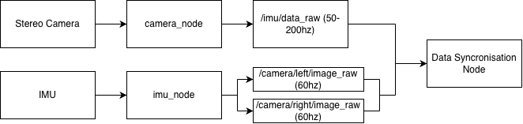

# VIO

A custom build 3D printed RC quadcopter using Visual Inertial Odometry (VIO) to navigate its surroundings.

## What it does
This drone navigates without GPS using Visual-Inertial Odometry (VIO): a downward-facing stereo camera and an IMU are fused onboard a Raspberry Pi 5 to estimate the drone's position and motion in real time. This enables autonomous flight in GPS-denied or GPS-degraded environments such as indoors, warehouses, disaster zones, defence settings, as well as in tasks like infrastructure inspection where navigating relative to the immediate surroundings matters more than global coordinates.

## Hardware
- Sing Board Computer: Raspberry Pi 5 8GB
- AI Accelerator: Raspberry Pi AI Hat+ 13 TOPS
- Flight ControllerL DAKEFPV H743 30x30
- Propellers: Gemfan 8x4x3
- Arms (Carbon Fibre Tube): 3K CF tube OD: 10mm ID: 6mm
- Motors: Anoel 2812 1115KV
- Down Firing Stereo Camera: 1MP OV9281 Global Shutter Binocular Synchronous
- ESC: DAKEFPV 8S 70A BLHeli_S 30x30
- External IMU: BMI088a
- Frame: 3D printed from PLA with design files to be uploaded soon

- Wiring diagram or photo

## How it works
The interesting bit. Architecture in plain English:
sensors → processing → decisions → actuators.
A simple diagram helps a lot.

## Design decisions
- Choice of camera
- Choice of raspberry pi
- Choice of OpenVINS as VIO Pipeline
(Complete all with detail)

## What went wrong
(1) symptom: what you observed, (2) cause: what was actually wrong, (3) fix or workaround, (4) optionally what you'd do differently next time. A bolded one-line title per problem so it skims well.
- Early driver code for IMU and Camera nodes was completely AI generated with little to know oversight or understanding of resulting code before it was implemented. When the IMU data became bad it was hard to distinguish whether it was a hardware or software problem. Rewrote/reviewed the driver code until I understood it. New rule: no code goes in that I can't explain.
- **Fully AI Generated Code With No Personal Understanding Made Debugging Impossible**
    - First the BMI088 never powered on, then the temporary MPU6500 replacement gave impossible values. There was no way for me to know whether the hardware or the software was then issue since all of the early code was completely AI generated with no understanding of the code. Most likely the BMI088 was completely fried and the MPIU 6500 was displaying false readings as a poorly made clone. The largest failiure was not understanding any of the code. All of the code for the drivers and nodes was then deleted and completely rewritten by hand (with the help of AI) and every line understood. A set of Rules were also adopted to prevent this AI issue from arising again. I learnt to understand every piece of code that went in as without that a project is doomed.
- **No Way Of Easily Swapping IMUs**
    - Once two of our IMU's died on us it became apparent that is was likely for this to occur again. Each time one had died, the IMU node file which was hardcoded to that particular IMU had to be rewritten, which was a big waste of time. To fix this, a section of code was added to the IMU node _init_driver_ method which alowed it to scan for the IMU in use (from the pre-described list) and load up the correct driver. I learnt that hardware often changes, so it is important to write the code so that new hardware can easily be swapped in as required (takes little extra time).
- **Incorrect Microcode Fed Into BMI270 Driver Causing Initialisation Faliure**
    - Once all of the driver code for the BMI270 had been written we ran into an issue, each time we attempted to load it up, the microcode upload failed. The main issue here (other than some incorrect register addresses) was that the Bosch '.c' file was opened in binary and the entire file upload, when only 8192 bytes actually contained the microcode. To fix this a _load_firmware method was created in the BMI270 driver which sliced out only the required bytes. These bytes were then loaded properly as bytes before being uploaded to the IMU. I've learnt to properly read through firmware files before feeding them in to ensure no descriptions get caught up.
## Results
Numbers, tables, videos. For the evals-style project this is the
core: conditions tested × success rates.

## What I'd do differently / next steps
Shows you're still thinking. 2–3 bullets.
